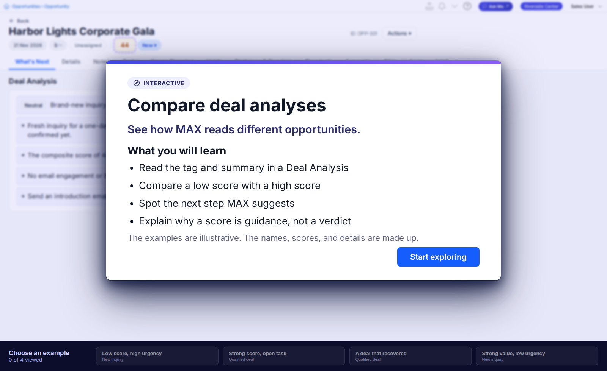

# MAX | Compare Deal Analyses [Interaction]

An open-exploration training interaction for MomentusMAX, built by the Momentus Digital Customer Success (DCS) team. Learners compare four example Deal Analyses to see how MAX reads different opportunities. It is a single self-contained HTML file, designed to be embedded in a Genially Learning Center lesson.



## What learners do

A title card introduces the interaction. Learners then choose examples from the bar below the stage ("Choose an example", "x of 4 viewed") and select each outlined part of the Deal Analysis to see what it tells them.

| Example | Score |
|---|---|
| Low score, high urgency | 44 |
| Strong score, open task | 73 |
| A deal that recovered | 54 |
| Strong value, low urgency | 76 |

Learning goals shown on the title card:

- Read the tag and summary in a Deal Analysis
- Compare a low score with a high score
- Spot the next step MAX suggests
- Explain why a score is guidance, not a verdict

All names, scores and details are fictional and labeled as illustrative in the interaction.

## Repo contents

| Path | Purpose |
|---|---|
| `index.html` | The interaction. Fonts, product captures and scripts are all inlined. No external requests |
| `docs/preview.png` | Preview image used in this README |
| `.github/workflows/pages.yml` | Optional: deploys `index.html` to GitHub Pages on push to `main` |
| `.nojekyll` | Tells GitHub Pages to serve the file as is |

Original file name: `MAX | Compare Deal Analyses [Interaction].html`. It is renamed to `index.html` here so Pages serves it at the root. Keep the original name when you upload it to the Learning Center. Windows cannot save `|` in file names, so a download may appear as `MAX _ Compare Deal Analyses [Interaction].html`. The page title inside the file is unaffected.

## Run locally

Open `index.html` in a browser, or:

```bash
python3 -m http.server 8000
# then visit http://localhost:8000
```

## Publish with GitHub Pages

1. Push to `main`.
2. In the repo, go to **Settings > Pages** and set **Source** to **GitHub Actions**.
3. The workflow publishes the page. Its URL appears in the workflow run.

Pages from a private repo requires a GitHub plan that supports it, and the published site may be public. See "Privacy" below.

## Embed in Genially or another page

The interaction is laid out at 1920 x 1176 and scales to fit its container.

```html
<iframe src="YOUR_PAGES_URL" title="MAX | Compare Deal Analyses [Interaction]"
        style="width:100%;aspect-ratio:1920/1176;border:0" allowfullscreen></iframe>
```

## Editing

The file is generated. The example data lives in the `DATA` object (as of 2026-10-22) inside the minified `srcdoc`. For content or design changes, rebuild from the DCS Interaction template and replace `index.html` rather than hand-editing.

## Privacy and ownership

This file contains captures of the Momentus MAX product interface and is Momentus internal training content. Keep the repository **private** unless Momentus approves public sharing. No license is granted; all rights reserved by Momentus Technologies.
